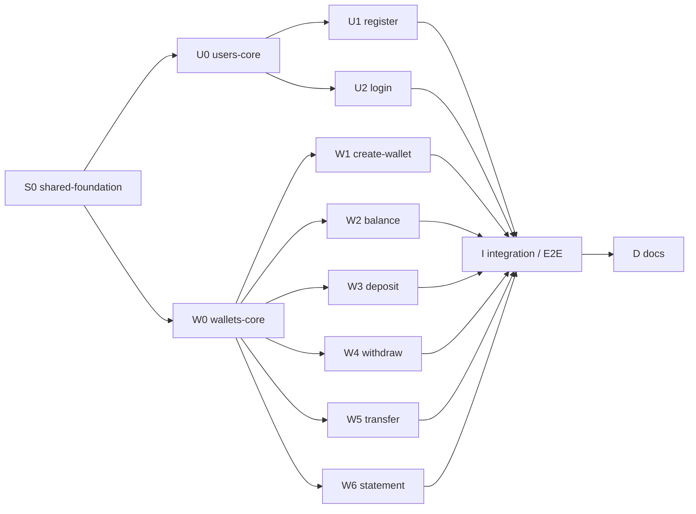

# Wallet API

API REST de uma carteira digital, desenvolvida para a disciplina de Cloud da PUCPR. Usuários se cadastram, autenticam-se com JWT e mantêm uma carteira própria na qual podem depositar, sacar, transferir para a carteira de outro usuário, consultar o saldo e o extrato. O código segue Vertical Slice Architecture com Clean Architecture dentro de cada slice e foi construído com TDD.

## Sumário

1. [Stack e como executar](#stack-e-como-executar)
2. [API](#api)
3. [Estrutura](#estrutura)
4. [Onde cada padrão foi aplicado](#onde-cada-padrão-foi-aplicado)
5. [Grafo de tarefas executado](#grafo-de-tarefas-executado)
6. [O que cada agente fez](#o-que-cada-agente-fez)
7. [Decisões e limitações conhecidas](#decisões-e-limitações-conhecidas)

## Stack e como executar

| Item | Versão / escolha |
|---|---|
| Linguagem | Java 25 (toolchain do Gradle) |
| Framework | Spring Boot 4.1.1 (Spring MVC, Validation) |
| Build | Gradle 9.7.1 com Kotlin DSL |
| Segurança | Spring Security como OAuth2 Resource Server, JWT HS256 (Nimbus), senhas com BCrypt |
| Persistência | Spring Data JPA (Hibernate) + H2 em memória |
| Testes | JUnit 5, AssertJ, Mockito, `@WebMvcTest`, `@DataJpaTest`, `@SpringBootTest` |

```bash
sh ./gradlew test       # suíte completa
sh ./gradlew bootRun    # sobe a API em http://localhost:8080
```

O `gradlew` está versionado sem bit de execução, então `./gradlew` falha num clone novo: rode `chmod +x gradlew` uma vez ou use `sh ./gradlew ...` como acima. Sem `java` no PATH (caso do WSL deste projeto), aponte `JAVA_HOME` para um JDK 25, por exemplo o baixado pelo IntelliJ em `~/.jdks/`:

```bash
JAVA_HOME=~/.jdks/ms-25.0.4.1 sh ./gradlew test
```

Configuração (`src/main/resources/application.yaml`):

| Propriedade | Variável de ambiente | Padrão | Observação |
|---|---|---|---|
| `wallet.security.jwt-secret` | `WALLET_JWT_SECRET` | segredo de desenvolvimento | Chave HMAC, mínimo de 32 bytes. A aplicação não sobe com um segredo menor (`SecurityConfig`). Defina sempre em ambientes reais. |
| `wallet.security.token-ttl` | - | `1h` | Validade do access token (`Duration`). |
| `spring.datasource.url` | - | `jdbc:h2:mem:wallet;DB_CLOSE_DELAY=-1` | H2 em memória, esquema gerado com `ddl-auto: update`. |

## API

Todas as rotas exceto `POST /users` e `POST /auth/login` exigem `Authorization: Bearer <token>`. Valores monetários são serializados sempre com 2 casas decimais (`"amount":10.50`).

| Método | Rota | Auth | Corpo | Resposta |
|---|---|---|---|---|
| POST | `/users` | pública | `{name, email, password}` (senha de 8 caracteres a 72 bytes) | 201 `{id, name, email}` + `Location` |
| POST | `/auth/login` | pública | `{email, password}` | 200 `{accessToken, tokenType:"Bearer", expiresIn}` |
| POST | `/wallets` | JWT | - | 201 `{id, ownerId, balance}` + `Location` |
| GET | `/wallets/{id}/balance` | JWT, dono | - | 200 `{walletId, balance}` |
| POST | `/wallets/{id}/deposits` | JWT, dono | `{amount}` | 201 `TransactionResponse` |
| POST | `/wallets/{id}/withdrawals` | JWT, dono | `{amount}` | 201 `TransactionResponse` |
| POST | `/wallets/{id}/transfers` | JWT, dono da origem | `{targetWalletId, amount}` | 201 `TransactionResponse` (`TRANSFER_OUT`) |
| GET | `/wallets/{id}/transactions` | JWT, dono | - | 200 `[TransactionResponse]`, mais recente primeiro |

`TransactionResponse`: `{id, walletId, type, amount, balanceAfter, counterpartyWalletId, occurredAt}`, com `type` em `DEPOSIT`, `WITHDRAWAL`, `TRANSFER_OUT`, `TRANSFER_IN`.

### Erros

Erros de negócio e de validação são devolvidos como `application/problem+json` (RFC 9457, `ProblemDetail`).

| Status | Quando |
|---|---|
| 400 | Falha de Bean Validation (campo em `errors.<campo>`), corpo malformado, UUID inválido no path |
| 401 | Sem token / token inválido (corpo vazio) ou credenciais inválidas no login (ProblemDetail, mesma resposta para e-mail desconhecido e senha errada) |
| 403 | A carteira existe mas pertence a outro usuário |
| 404 | Carteira inexistente |
| 409 | E-mail já cadastrado, segunda carteira para o mesmo usuário, atualização concorrente (lock otimista) |
| 422 | Regra de negócio: saldo insuficiente, transferência para a mesma carteira, valor com mais de 2 casas decimais ou acima do limite (zero e negativo são barrados antes, com 400), e-mail com formato inválido para o domínio |

### Exemplo com curl

```bash
API=http://localhost:8080

# 1. cadastro de dois usuários
curl -s -X POST $API/users -H 'Content-Type: application/json' \
  -d '{"name":"Ana","email":"ana@example.com","password":"senha-forte-1"}'
curl -s -X POST $API/users -H 'Content-Type: application/json' \
  -d '{"name":"Bruno","email":"bruno@example.com","password":"senha-forte-2"}'

# 2. login (jq extrai o token)
ANA=$(curl -s -X POST $API/auth/login -H 'Content-Type: application/json' \
  -d '{"email":"ana@example.com","password":"senha-forte-1"}' | jq -r .accessToken)
BRUNO=$(curl -s -X POST $API/auth/login -H 'Content-Type: application/json' \
  -d '{"email":"bruno@example.com","password":"senha-forte-2"}' | jq -r .accessToken)

# 3. cada um cria sua carteira
WA=$(curl -s -X POST $API/wallets -H "Authorization: Bearer $ANA" | jq -r .id)
WB=$(curl -s -X POST $API/wallets -H "Authorization: Bearer $BRUNO" | jq -r .id)

# 4. depósito na carteira da Ana
curl -s -X POST $API/wallets/$WA/deposits -H "Authorization: Bearer $ANA" \
  -H 'Content-Type: application/json' -d '{"amount":100.00}'

# 5. transferência Ana -> Bruno
curl -s -X POST $API/wallets/$WA/transfers -H "Authorization: Bearer $ANA" \
  -H 'Content-Type: application/json' -d "{\"targetWalletId\":\"$WB\",\"amount\":30.50}"

# 6. saldo e extrato
curl -s $API/wallets/$WA/balance -H "Authorization: Bearer $ANA"        # {"walletId":"...","balance":69.50}
curl -s $API/wallets/$WA/transactions -H "Authorization: Bearer $ANA"   # [TRANSFER_OUT, DEPOSIT]
```

## Estrutura

```
com.example.wallet
├── WalletApplication
├── shared
│   ├── domain       DomainException (sealed) + categorias NotFound, Conflict, BusinessRule, Forbidden, Unauthorized
│   ├── web          GlobalExceptionHandler (ProblemDetail)
│   └── security     SecurityConfig (JWT HS256 stateless, BCrypt), JwtProperties
├── users
│   ├── domain       User, Email, exceções, portas UserRepository e PasswordHasher
│   ├── persistence  UserJpaEntity, SpringDataUserRepository, JpaUserRepository (adapter)
│   ├── security     SpringPasswordHasher (adapter BCrypt)
│   ├── register     slice POST /users
│   └── login        slice POST /auth/login (+ porta TokenIssuer, adapter JwtTokenIssuer)
└── wallets
    ├── WalletsModuleConfig   bean Clock (UTC, resolução de microssegundos)
    ├── domain       Money, Wallet, Transaction, TransactionType, exceções, portas WalletRepository e TransactionHistory
    ├── persistence  WalletJpaEntity, TransactionJpaEntity, repositórios Spring Data, WalletPersistenceAdapter
    ├── web          TransactionResponse (compartilhado por 4 slices)
    ├── create       POST /wallets
    ├── balance      GET /wallets/{id}/balance
    ├── deposit      POST /wallets/{id}/deposits
    ├── withdraw     POST /wallets/{id}/withdrawals
    ├── transfer     POST /wallets/{id}/transfers
    └── statement    GET /wallets/{id}/transactions
```

Cada slice contém o mesmo conjunto pequeno de arquivos, por exemplo `wallets/deposit`:

| Arquivo | Papel |
|---|---|
| `DepositUseCase` | Porta de entrada (interface do caso de uso) |
| `DepositCommand` (ou `XxxQuery` em leituras) | Dados de entrada do caso de uso, sem anotações de framework |
| `DepositInteractor` | Orquestra a regra: carrega a carteira, verifica dono, chama o domínio, salva. Java puro |
| `DepositController` + `DepositRequest` | Endpoint HTTP, Bean Validation, extração do `sub` do JWT |
| `DepositConfig` | `@Configuration` que instancia o interactor com `@Bean` |
| `src/test/.../deposit/` | `DepositInteractorTest` (fake em memória), `DepositControllerTest` (`@WebMvcTest`), `InMemoryWallets` |

## Onde cada padrão foi aplicado

### Vertical Slice Architecture

Cada endpoint é uma fatia vertical: endpoint + comando + validação + orquestração da regra + wiring + testes, num único pacote (`users/register`, `users/login`, `wallets/{create,balance,deposit,withdraw,transfer,statement}`).

| Item do checklist | Como foi atendido |
|---|---|
| Slice pequeno | 5 a 10 classes de produção por slice (10 no login, que inclui a porta `TokenIssuer` e seu adapter), cada interactor com um único método público curto |
| Responsabilidade clara | Um caso de uso por slice; leituras (`GetBalanceQuery`, `GetStatementQuery`) separadas de escritas |
| Testes perto | `src/test` espelha o pacote: `wallets/transfer/TransferInteractorTest` e `TransferControllerTest` ao lado do código do slice |
| Shared mínimo | `shared` contém só a hierarquia de exceções, o handler HTTP e a configuração de segurança. O domínio de cada módulo (`users/domain`, `wallets/domain`) é compartilhado apenas dentro do módulo |
| Dependências explícitas | Construtores recebem só as portas que usam (`DepositInteractor(WalletRepository, Clock)`); as classes `*Config` dos slices e quase todos os controllers são package-private, e nenhum slice importa classes de outro slice |

Duplicação foi tratada caso a caso:

- Fakes de teste duplicados de propósito: cada slice tem seu próprio `InMemoryWallets` (`wallets/{create,balance,deposit,withdraw,statement}/InMemoryWallets.java` e uma classe aninhada em `TransferInteractorTest`), ajustado ao que aquele slice precisa verificar. Isso mantém os slices independentes e foi o que permitiu desenvolvê-los em paralelo.
- Contrato HTTP compartilhado: `wallets/web/TransactionResponse` é usado por depósito, saque, transferência e extrato, porque as quatro respostas precisam ter exatamente o mesmo formato (e a mesma serialização de dinheiro). Duplicar esse record seria duplicar uma regra.
- Regra de dono e de saldo vivem no agregado (`Wallet.ensureOwnedBy`, `Wallet.withdraw`, `Wallet.transferTo`), não repetidas nos interactors.

### Clean Architecture

| Camada | Onde está |
|---|---|
| Entities | `users/domain`: `User`, `Email`; `wallets/domain`: `Wallet` (agregado), `Money`, `Transaction`, `TransactionType`; exceções de domínio sobre `shared/domain/DomainException` |
| Use Cases | Porta de entrada `XxxUseCase` + `XxxCommand`/`XxxQuery` + `XxxInteractor`; portas de saída `UserRepository`, `PasswordHasher`, `TokenIssuer`, `WalletRepository`, `TransactionHistory` |
| Interface Adapters | Controllers e records de request/response, `TransactionResponse`, `GlobalExceptionHandler`, `JpaUserRepository`, `WalletPersistenceAdapter`, `SpringPasswordHasher`, `JwtTokenIssuer`, `UserJpaEntity`, `WalletJpaEntity`, `TransactionJpaEntity` |
| Frameworks & Drivers | Spring Boot, Spring MVC, Spring Security (`SecurityConfig`), Spring Data JPA (`SpringDataUserRepository`, `WalletJpaRepository`, `TransactionJpaRepository`), H2, classes `*Config` |

- Regra de dependência: domínio e casos de uso não importam nada de Spring nem de `jakarta`. Verificado com grep sobre `*/domain/*.java`, `*Interactor`, `*UseCase`, `*Command`, `*Query` e `TokenIssuer` (`grep -lE '^import (org\.springframework|jakarta)'` sem resultados), checagem repetida pelo revisor do nó I sobre o código inteiro.
- Inversão de dependência por portas: interactors dependem de interfaces (`UserRepository`, `PasswordHasher`, `TokenIssuer`, `WalletRepository`, `TransactionHistory`) implementadas por adapters (`JpaUserRepository`, `SpringPasswordHasher`, `JwtTokenIssuer`, `WalletPersistenceAdapter`). As portas de saída ficam no pacote `domain` do módulo (ou no slice, no caso de `TokenIssuer`, usado só pelo login), sem um pacote extra só para elas.
- Entidade JPA separada do domínio: `WalletJpaEntity.from(Wallet)` / `toDomain()` e o mesmo para `UserJpaEntity` e `TransactionJpaEntity`. Anotações de persistência, `@Version` e `Persistable` não vazam para `Wallet` ou `User`.
- Nenhuma entidade como contrato HTTP: controllers devolvem records (`RegisterUserResponse`, `CreateWalletResponse`, `BalanceResponse`, `LoginResponse`, `TransactionResponse`), nunca `User`/`Wallet` ou entidades JPA.
- Wiring sem anotações no núcleo: interactors são classes Java comuns, instanciadas por `@Bean` em `RegisterUserConfig`, `LoginConfig`, `CreateWalletConfig`, `GetBalanceConfig`, `DepositConfig`, `WithdrawConfig`, `TransferConfig`, `GetStatementConfig`.
- Transações dentro do adapter: `@Transactional` está só em `WalletPersistenceAdapter` (o `save(Wallet...)` grava carteiras e transações pendentes atomicamente). O interactor de transferência chama `wallets.save(source, target)` uma vez e não sabe que existe transação de banco.

### SOLID

| Princípio | Exemplo concreto |
|---|---|
| SRP | `DepositController` só traduz HTTP para `DepositCommand`; `DepositInteractor` só orquestra; `Wallet` aplica a regra; `WalletPersistenceAdapter` só persiste. `GlobalExceptionHandler` é o único lugar que conhece status HTTP |
| OCP | `DomainException` é `sealed` e permite apenas cinco categorias abstratas (`NotFoundException`, `ConflictException`, `BusinessRuleException`, `ForbiddenException`, `UnauthorizedException`). `GlobalExceptionHandler` faz um `switch` exaustivo sobre as categorias. Uma exceção nova (ex.: `SameWalletTransferException extends BusinessRuleException`) ganha o status correto sem tocar no handler |
| LSP | O contrato de `WalletRepository.save` (documentado na interface: atômico, limpa as transações pendentes, falha com lock otimista em carteira desatualizada) é cumprido por `WalletPersistenceAdapter`; os fakes `InMemoryWallets` cumprem a parte que os interactors observam (gravar e limpar as transações pendentes), e o de `TransferInteractorTest` também devolve cópias, como um banco faria. O adapter ainda grava em ordem de id para evitar deadlock, verificado em `WalletPersistenceAdapterOrderingTest` |
| ISP | Carteira e histórico são portas separadas: `WalletRepository` (`findById`, `existsByOwnerId`, `save`) e `TransactionHistory` (`findByWalletId`). Só `GetStatementInteractor` depende de `TransactionHistory`; os outros cinco interactors de carteira não enxergam o histórico. Um único adapter implementa as duas |
| DIP | Interactors recebem portas por construtor (`LoginInteractor(UserRepository, PasswordHasher, TokenIssuer)`), e a escolha da implementação fica nas classes `*Config` |

Onde SOLID deliberadamente não foi aplicado: não há interface sem variação. Controllers, entidades JPA, `Money`, `Wallet` e os adapters são classes concretas; o relógio é o próprio `java.time.Clock` injetado (bean em `WalletsModuleConfig`), sem uma porta `TimeProvider` própria. Interfaces existem apenas onde há duas implementações reais (produção e fake de teste) ou fronteira de camada.

### Clean Code

- Nomes que revelam intenção: `Wallet.ensureOwnedBy`, `Wallet.transferTo`, `InsufficientFundsException`, `WalletAccessDeniedException`, `EmailAlreadyRegisteredException`, `Money.of`.
- Métodos pequenos: interactors com um método público de poucas linhas e helpers privados (`TransferInteractor.load`, `LoginInteractor.findUser`).
- Erros como exceções de domínio, traduzidas num único `@RestControllerAdvice` (`GlobalExceptionHandler`) para `ProblemDetail`; nenhum controller tem `try/catch`.
- Valores com invariantes viram tipos: `Money` (escala 2, rejeita mais casas decimais e valores fora do limite), `Email` (normaliza e valida).
- Dados sensíveis protegidos: `User.toString`, `RegisterUserRequest.toString` e os records de login mascaram senha/hash (`PasswordMaskingTest`).
- Testes em Arrange-Act-Assert com blocos separados por linha em branco e nomes descritivos.

### TDD

O ciclo Red/Green está visível no histórico do branch `feat/digital-wallet`: cada comportamento entra como `test(<escopo>)` (teste falhando) seguido de `feat(<escopo>)` (código mínimo, suíte verde). Não há commits `refactor(...)` dedicados: as melhorias de design vieram das rodadas de follow-up dos revisores, registradas como novos pares `test`/`feat`/`fix` (ex.: ordenação por id no save, `Persistable` sem SELECT extra, mascaramento de senha em `toString`). Exemplo do slice de saque:

```
d7e903d test(wallets-withdraw): withdrawal decreases balance and persists WITHDRAWAL
aa76034 feat(wallets-withdraw): withdraw from wallet and persist transaction
8c25c61 test(wallets-withdraw): reject withdrawal from unknown wallet
19a019e feat(wallets-withdraw): throw WalletNotFoundException for unknown wallet
5076136 test(wallets-withdraw): reject withdrawal by non-owner without saving
2b50b0a feat(wallets-withdraw): enforce wallet ownership before withdrawing
```

- Ordem de construção: primeiro testes unitários sem Spring para domínio (`MoneyTest`, `WalletTest`, `UserTest`, `EmailTest`) e casos de uso (`*InteractorTest` com fakes em memória), depois adapters (`@DataJpaTest` em `JpaUserRepositoryTest` e `WalletPersistenceAdapterTest`; `@WebMvcTest` nos controllers), por fim E2E (`e2e/WalletJourneyE2ETest`, `e2e/ErrorContractE2ETest`).
- Testes de contrato que passaram de primeira (porque o código existente já cobria o comportamento) foram commitados sozinhos como `test(...)` e não justificaram código novo, por exemplo `117354b test(wallets-statement): empty array, 401, 404 and 403 contract` e os três commits do nó I.
- Correções vindas de revisão também seguiram Red/Green: `ecba77c test(shared-security): reject jwt secrets shorter than 32 bytes` seguido de `5243ea0 feat(shared-security): fail fast on jwt secrets shorter than 32 bytes`.
- Números do branch antes deste README (sem merges): 153 commits, sendo 82 `test`, 65 `feat`, 3 `fix`, 3 `chore` e nenhum `refactor`.

Suíte final (`sh ./gradlew cleanTest test`, contada nos XML de `build/test-results`): 179 testes em 37 classes, 0 falhas, 0 ignorados.

| Camada | Classes | Testes |
|---|---|---|
| Domínio (JUnit puro) | `EmailTest`, `UserTest`, `UserExceptionsTest`, `MoneyTest`, `WalletTest`, `WalletExceptionsTest` | 50 |
| Casos de uso (JUnit puro + fakes) | 8 `*InteractorTest` | 32 |
| Adapters e suporte sem contexto Spring | `JwtTokenIssuerTest`, `JwtRoundTripTest`, `SpringPasswordHasherTest`, 2 `PasswordMaskingTest`, `TransactionResponseTest`, `WalletsModuleConfigTest`, `WalletPersistenceAdapterOrderingTest` | 14 |
| Persistência (`@DataJpaTest` + H2) | `JpaUserRepositoryTest`, `WalletPersistenceAdapterTest` | 11 |
| Web (`@WebMvcTest`) | 8 `*ControllerTest`, `GlobalExceptionHandlerTest`, `SecurityConfigTest` | 57 |
| Contexto completo (`@SpringBootTest`) | `WalletApplicationTests`, `WalletJourneyE2ETest`, `ErrorContractE2ETest` | 15 |
| **Total** | **37** | **179** |

Os testes E2E sobem o contexto completo (filtros do Spring Security, JPA, H2) e chamam a API por MockMvc sem nenhum mock: o token vem de um `POST /auth/login` real e é reenviado no header `Authorization`.

## Grafo de tarefas executado

O trabalho foi dividido em nós de um DAG e executado por múltiplos agentes de IA, orquestrados por um agente coordenador.



Ondas executadas de fato:

| Onda | Nós |
|---|---|
| 1 | S0 |
| 2 | U0 e W0 em paralelo |
| 3 | U1, U2 e W1 em paralelo; depois W3, W4, W5, W2, W6 conforme vagas liberavam, junto com os follow-ups de revisão de U0, U1, U2, W0, W3, W4 e W5 |
| 4 | I |
| 5 | D |

Como a orquestração funcionou:

- Cada nó teve um agente implementador e um agente revisor independente. O implementador seguia um brief comum (arquitetura, contrato HTTP, regras de TDD e de commit) mais o brief do nó.
- Nós paralelos rodaram em git worktrees isoladas, uma branch por agente. O coordenador só fazia `git merge --no-ff` (`chore: integrate node X`) depois do veredito APPROVED do revisor, conferindo antes a branch correta com `git worktree list`.
- Achados menores do revisor voltavam ao mesmo implementador como rodada de follow-up, integrada como `chore: integrate node X review follow-up(s)`.
- Nós sequenciais (S0, I, D) commitaram direto no branch.
- Concorrência limitada a cerca de 3 builds Gradle simultâneos por causa da RAM do WSL (9 GB).

## O que cada agente fez

| Nó | Implementador | Revisor | Integração |
|---|---|---|---|
| S0 shared-foundation | Dependências (webmvc, data-jpa, validation, security, oauth2-resource-server, h2 e starters de teste do Boot 4), `application.yaml`, `DomainException` sealed + 5 categorias, `GlobalExceptionHandler`, `SecurityConfig` + `JwtProperties`. 16 testes | Rodada 1 CHANGES_REQUESTED: bloqueante, `@WebMvcTest` sem `controllers` carregaria todos os controllers e quebraria quando os slices entrassem; menores: tamanho do segredo JWT não validado, propriedade de problem details sem efeito, `DataIntegrityViolationException` virando 500. Rodada 2 APPROVED | direto no branch (`007bf8b`, `4541eb8`, `5243ea0`, `bfc343b` são as correções) |
| U0 users-core | `Email`, `User` (`register`/`rehydrate`), exceções (422, 409, 401), portas `UserRepository`/`PasswordHasher`, `UserJpaEntity` + `JpaUserRepository` (`saveAndFlush`, e-mail único), `SpringPasswordHasher`. 19 commits, suíte com 36 testes após o merge | APPROVED; menores: `User.toString` expunha o hash, faltavam checagens de null | `64cc9dc`, follow-up `86fe6d1` |
| W0 wallets-core | `Money` (escala 2, até 17 dígitos inteiros), `Transaction`/`TransactionType`, agregado `Wallet`, 6 exceções, portas `WalletRepository`/`TransactionHistory`, entidades JPA + `WalletPersistenceAdapter` (`@Transactional`, `@Version`, dono único), `TransactionResponse`, bean `Clock`. 16 commits, suíte com 58 testes após o merge | APPROVED; menores: risco de deadlock em transferências opostas concorrentes, SELECT extra a cada insert, relógio em nanos vs coluna em micros | `c07c6f4`, follow-up `8b5ad73` (save em ordem de id, `Persistable.isNew`, relógio em microssegundos) |
| U1 register | `RegisterUserUseCase`/`RegisterUserInteractor`/`RegisterUserController`, `POST /users` 201 + `Location`, validação. 9 commits | APPROVED; menores: limite de 72 bytes do BCrypt vs `@Size` em caracteres (senha multibyte gerava 500), asserção de hasher não chamado, senha no `toString` do record | `c76b212`, follow-up `f0c1b91` (`@MaxUtf8Bytes`, mascaramento) |
| U2 login | Porta `TokenIssuer` + `AccessToken`, `LoginInteractor` (401 uniforme para e-mail desconhecido, senha errada ou e-mail malformado; verificação contra hash fictício para igualar tempo), `JwtTokenIssuer` (`sub`, `iat`, `exp`, `email`), `POST /auth/login`. 12 commits | APPROVED; menores: senha no `toString` do record, teste de guarda para a senha fictícia | `c8ac9d5`, follow-up `91ed5ce` |
| W1 create-wallet | `POST /wallets` 201 + `Location`, uma carteira por usuário. 8 commits | APPROVED; menor: um commit `feat` deixou a suíte vermelha até o commit de config, virou regra no brief dos slices (config no mesmo commit verde do controller) | `e7a8167` |
| W3 deposit | `POST /wallets/{id}/deposits`. 13 commits | APPROVED; menores: um commit intermediário vermelho (mantido), escala do dinheiro verificada só numericamente | `f066089`, follow-up `610bb27` |
| W4 withdraw | `POST /wallets/{id}/withdrawals`. 12 commits | APPROVED; menores: escala do dinheiro; `sub` não-UUID daria 500 (aceito, tokens são emitidos pela própria API) | `b39501f`, follow-up `b0d8049` |
| W5 transfer | `POST /wallets/{id}/transfers`: origem 404, depois 403, depois destino 404, `transferTo`, um único `save(source, target)`. 6 commits | APPROVED; verificou atomicidade, nada salvo em falha e que um não-dono não consegue sondar a existência do destino; menores: escala do dinheiro, teste de contrato para mais de 2 casas | `ba2429e`, follow-up `8dd5ef6` |
| W2 balance | `GET /wallets/{id}/balance`, query somente leitura. 9 commits | APPROVED; verificou que UUID malformado no path vira 400 via `ResponseEntityExceptionHandler` | `c066856` |
| W6 statement | `GET /wallets/{id}/transactions`, mais recente primeiro, sem paginação. 10 commits | APPROVED; menores: documentar ausência de paginação e a ordem em timestamps iguais | `063713b` |
| I integration | `EndToEndTest` (helpers), `WalletJourneyE2ETest` (jornada completa), `ErrorContractE2ETest` (13 casos de erro), sem mocks. Tudo passou na primeira execução: nenhum bug de integração, nenhuma mudança de produção. 179 testes no total | APPROVED; grep no código inteiro confirmou zero imports de Spring/jakarta em domínio e casos de uso; menor: asserções mais fortes de dinheiro e extrato, aplicadas em `18de80d` | direto no branch (`2737df7`, `71984e6`, `18de80d`) |
| D docs | Este README | - | direto no branch |

Bugs relevantes pegos pelos revisores antes do merge:

| Achado | Nó | Correção |
|---|---|---|
| `@WebMvcTest` sem lista de controllers carregaria todos os slices e quebraria a suíte | S0 | `007bf8b`: testes restritos aos controllers de prova |
| BCrypt considera só 72 bytes; `@Size(max = 72)` conta caracteres, então senhas multibyte geravam 500 | U1 | `40f3116`: constraint `@MaxUtf8Bytes` |
| Senha em texto puro no `toString` de request/command | U1, U2 | `d5e3ebe`, `683cf1d`: mascaramento |
| Deadlock possível em transferências opostas simultâneas (A para B e B para A) | W0 | `WalletPersistenceAdapter.save` grava em ordem de id |
| SELECT extra antes de cada insert de transação (merge do Spring Data) | W0 | `TransactionJpaEntity implements Persistable<UUID>` |
| Relógio com nanossegundos vs `TIMESTAMP(6)` no banco: instantes lidos diferentes dos gravados | W0 | `Clock.tick` de 1 µs em `WalletsModuleConfig` |

Incidentes:

- Durante S0, `src/main` foi movido para `src/test/main` por algo externo ao agente (provavelmente a IDE); o conteúdo estava intacto e foi restaurado.
- Relatórios de implementadores às vezes citavam a branch de worktree errada; o coordenador conferia com `git worktree list` antes de cada merge.
- A sessão do coordenador reiniciou uma vez (após a revisão de W6); os briefs do scratchpad foram recriados e nenhum código se perdeu, pois tudo estava commitado.

## Decisões e limitações conhecidas

- Banco H2 em memória apenas, com `ddl-auto: update` e sem migrations.
- Extrato sem paginação; a ordem entre transações com o mesmo timestamp (precisão de microssegundos) é indefinida.
- Valores com mais de 2 casas decimais e e-mails que passam no `@Email` mas são inválidos para o domínio retornam 422 (regra de domínio), não 400.
- Os headers `Location` de `POST /users` e `POST /wallets` apontam para `/users/{id}` e `/wallets/{id}`, que não têm endpoint `GET`.
- Um JWT com `sub` que não seja UUID geraria 500; não é alcançável porque só tokens emitidos pela própria API são aceitos.
- O 401 de requisição sem token vem do entry point do Spring Security com corpo vazio, não como `ProblemDetail`.
- Conflitos de concorrência (lock otimista) retornam 409 e o cliente deve repetir a operação; não há retry automático.

### Próximos passos para o deploy em cloud

- Adicionar o driver do PostgreSQL e um profile `cloud` com `spring.datasource.*` lido de variáveis de ambiente, mantendo H2 para desenvolvimento e testes.
- Trocar `ddl-auto: update` por migrations versionadas (Flyway) e usar `ddl-auto: validate`.
- Injetar `WALLET_JWT_SECRET` (e as credenciais do banco) pelo gerenciador de segredos da plataforma, nunca pelo `application.yaml`.
